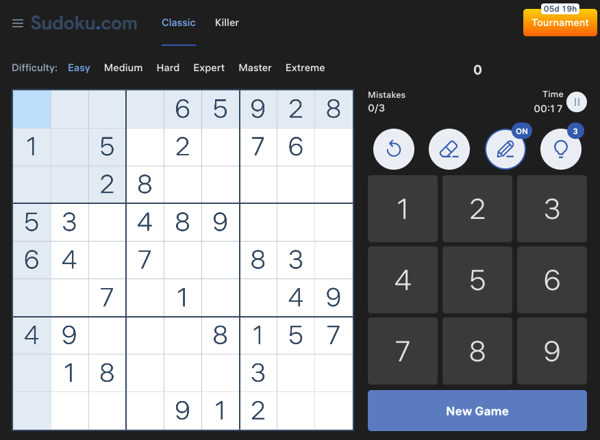

# BetterSudoku

Keyboard shortcuts, dark mode, and clutter removal for [Sudoku.com](https://www.sudoku.com). Settings are stored locally in your browser.

This extension can be added to Firefox [here](https://addons.mozilla.org/en-GB/firefox/addon/bettersudoku/)

## Features

- **Rebindable keyboard shortcuts** for common game actions
- **Dark mode** for the Sudoku.com interface (toggle from the toolbar popup)
- **Clean UI** — hide the sidebar, cookie banner, and tips (toggle from the toolbar popup)
- **Options page** to customize shortcuts

## Default shortcuts

| Key | Action |
|-----|--------|
| `Shift` | Toggle note mode |
| `p` | Pause / Unpause timer |
| `u` | Undo move |
| `h` | Show hint |
| `Backspace` | Erase cell |
| `r` | Continue game (after a mistake) |

You are able to rebind these at any time via **Customize Shortcuts** in the popup.

## Privacy

Settings (dark mode, clean UI, shortcuts) are saved with `browser.storage.local` only. The extension does **not** collect, send, or store any personal data.

## Dark mode limitation

The Sudoku.com playfield is drawn on a **canvas** with fixed colors. Cell, given, note, and error colors cannot be themed with CSS. Dark mode covers the surrounding interface (header, numpad, menus, stats), not the board cells themselves.

## Screenshot

## Footnote

Special thanks to derek333x for creating the original extension which was the basis for this project.
